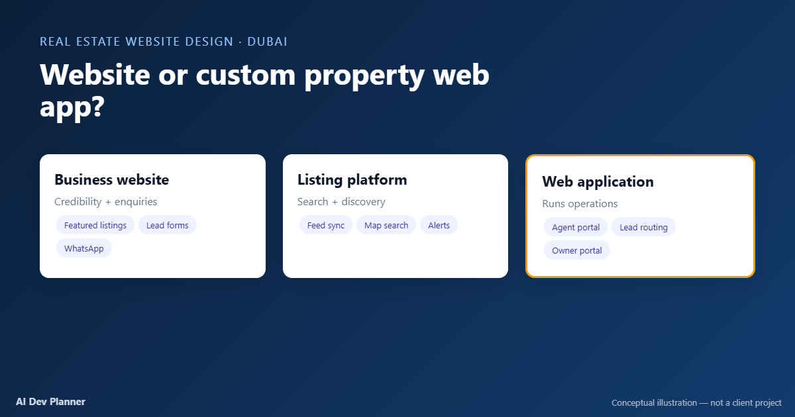
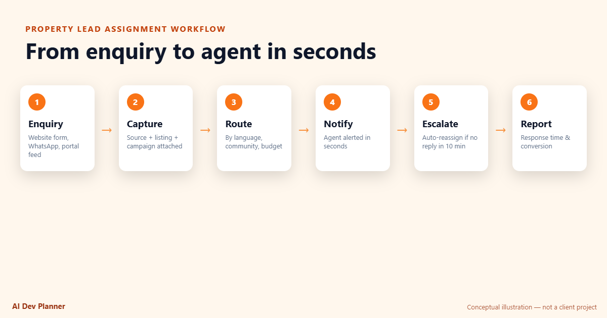
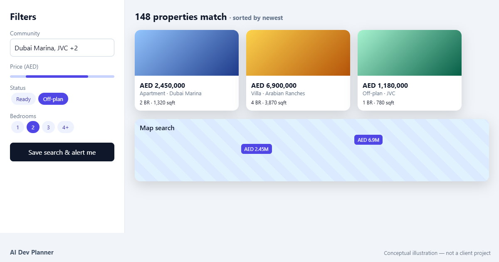
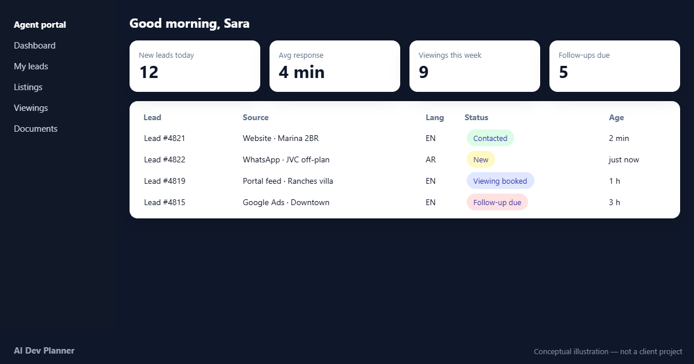
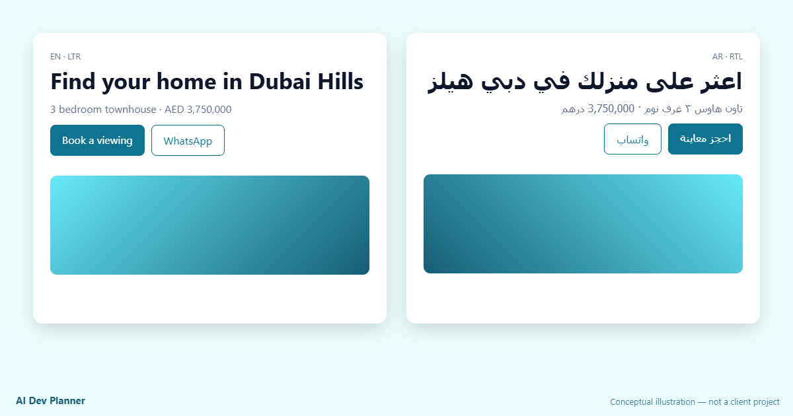
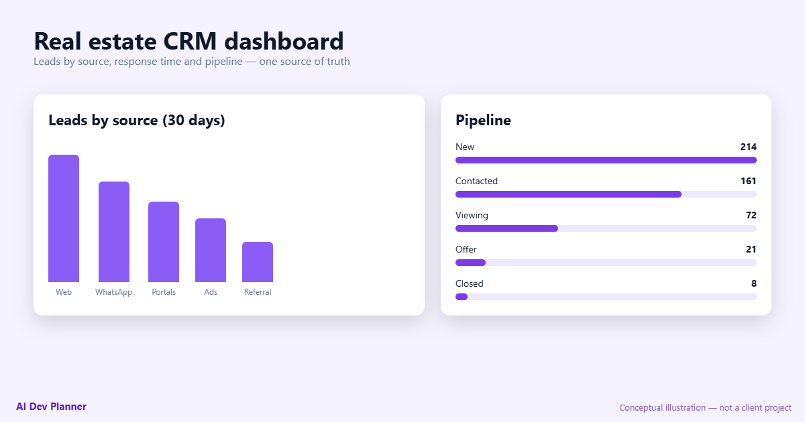
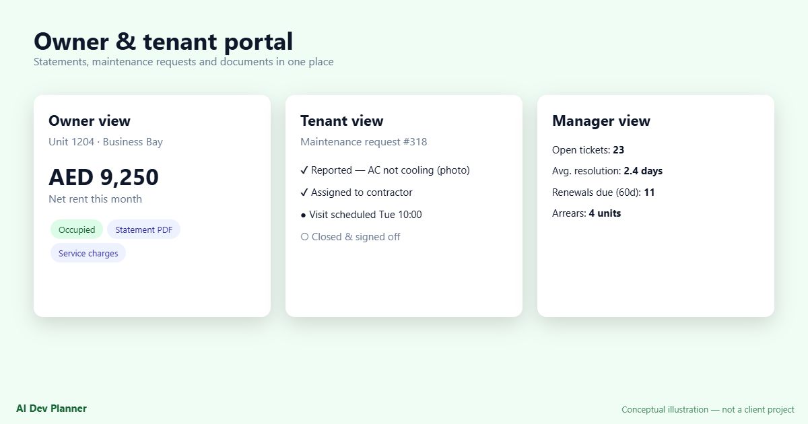
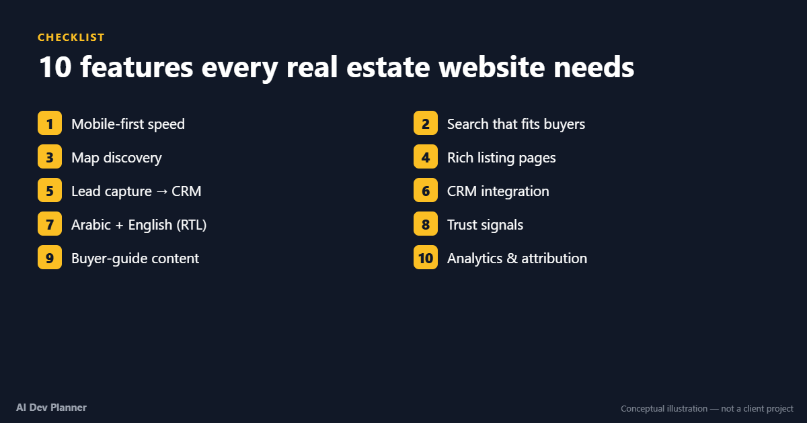
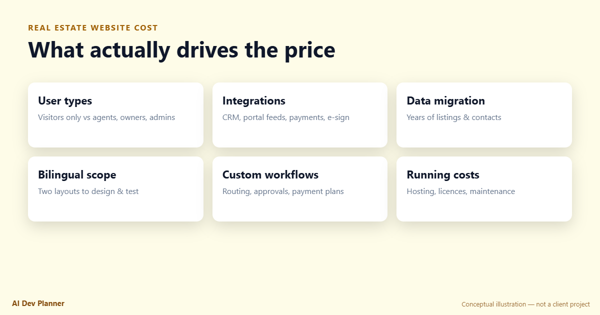
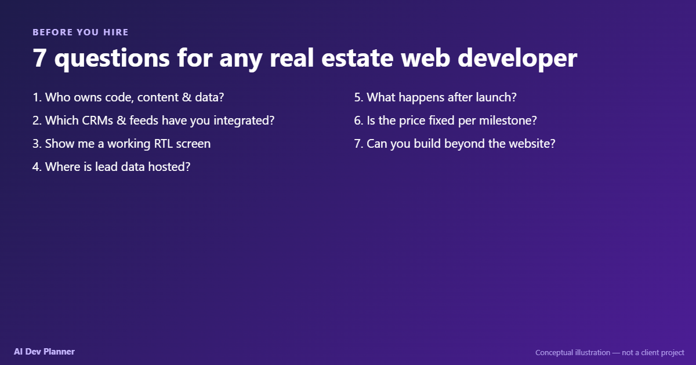

# Real Estate Platform Planning Kit

A practical, vendor-neutral checklist for planning **real estate websites, property listing platforms and real estate web applications** — written for brokerages, developers and property managers in Dubai/UAE and the US, and for the developers who build for them.

Maintained by [AI Dev Planner](https://aidevplanner.com/industries/real-estate-proptech). Contributions and issues welcome.



> All images in this repo are conceptual illustrations, not client projects.

---

## 1. Pick the right level

| Level | Use when | You'll need |
|---|---|---|
| **Business website** | < ~50 listings, one editor, enquiries go to a small team | CMS, fast mobile theme, forms → CRM, WhatsApp, SEO |
| **Listing platform** | Listings live in a CRM/feed, multiple agents, buyers need real search | Listing database, feed importer, filters + map search, per-listing SEO |
| **Web application** | Agents, owners, tenants or partners need to log in; workflows and reporting matter | Custom backend, roles & permissions, workflows, integrations |

**Signals you've outgrown a CMS:** listings in 2+ systems · leads need routing · more than one user type logs in · reports are assembled by hand · listings edited by several people.

## 2. Requirements checklist

### Public site
- [ ] Mobile performance budget (LCP target, AVIF/WebP, lazy loading, CDN)
- [ ] Search filters that match buyers: community, building, purpose, ready/off-plan, price band, beds, furnishing
- [ ] Map search with community boundaries
- [ ] Listing page: gallery, floor plan, video/360°, amenities, service charge, payment plan, permit info
- [ ] One indexable URL per listing + structured data; graceful handling of sold/archived listings
- [ ] Off-plan project pages with gated brochure downloads
- [ ] Saved searches and email/WhatsApp alerts
- [ ] Trust: broker/agent credentials, real reviews, privacy policy

### Leads
- [ ] Every form, WhatsApp click and call tap captured as an event with listing + campaign source
- [ ] De-duplication by phone/email
- [ ] Routing rules (language, community, budget, availability)
- [ ] Response-time escalation / re-assignment
- [ ] Consent captured and stored

### Integrations (name each one)
- [ ] CRM: which one, which objects, which direction
- [ ] Portal feeds: import, export, or both
- [ ] WhatsApp Business API
- [ ] Maps / geocoding
- [ ] E-signature, payments (if applicable)
- [ ] Analytics + ad platforms (conversion import)

### Arabic & English
- [ ] Route-level locales (`/en/…`, `/ar/…`) with `hreflang`
- [ ] `dir="rtl"` + CSS logical properties
- [ ] Arabic typography and real Arabic copy in testing
- [ ] Locale-aware price/number formatting
- [ ] Separate slugs and SEO metadata per language

### Data & compliance
- [ ] Source of truth for listings agreed in writing
- [ ] Hosting region agreed (e.g. UAE cloud region) and account ownership
- [ ] Personal data handling reviewed against UAE Federal Decree-Law No. 45 of 2021 (confirm with your legal adviser)
- [ ] Marketing permit fields in the listing model (Dubai advertising permits via DLD)
- [ ] Code, content and data ownership in the contract

## 3. Minimal listing data model

```sql
listings(id, reference, purpose, completion, property_type,
         community_id, building_id, bedrooms, bathrooms, size_sqft,
         price_aed, service_charge, permit_number, location geography(Point),
         status, agent_id, source, updated_at)

listing_translations(listing_id, locale, title, description, slug)
communities(id, name_en, name_ar, boundary geography(Polygon))
leads(id, channel, listing_id, locale, utm jsonb, consent, assigned_agent_id, created_at)
```

## 4. Lead routing reference flow



1. Enquiry arrives (form, WhatsApp, portal)
2. Captured with source, listing and campaign
3. Routed by rules
4. Agent notified
5. Escalated if no response in the agreed window
6. Reported: response time and conversion by channel

## 5. Questions to ask any development vendor

1. Who owns the code, content and data?
2. Which CRMs and feeds have you integrated — and how?
3. Can you show a working RTL screen?
4. Where will lead data be hosted?
5. What's the warranty and post-launch support?
6. Is pricing fixed per milestone?
7. Can you build beyond the website (portals, dashboards)?

## More visuals

| | |
|---|---|
|  |  |
|  |  |
|  |  |
|  |  |

## About

AI Dev Planner is a remote custom software engineering team (Islamabad, Pakistan) building web applications, [customer portals](https://aidevplanner.com/services/customer-portal-development) and [SaaS platforms](https://aidevplanner.com/services/saas-development) for US, UK, EU and [GCC businesses](https://aidevplanner.com/web-development-agency-gcc). Planning a real estate platform? Try the [MVP cost calculator](https://aidevplanner.com/mvp-cost-calculator).

License: CC BY 4.0 for the text; images © AI Dev Planner.
